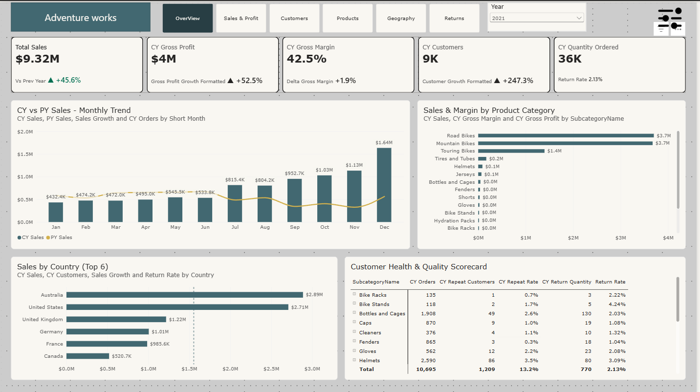
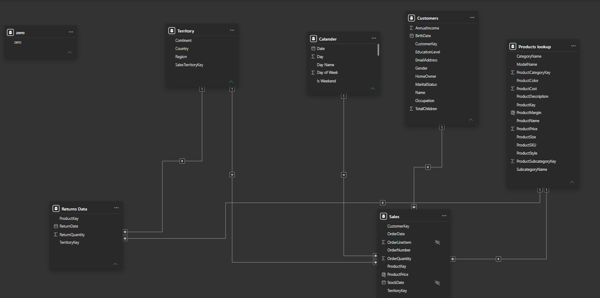

# 🚴 Adventure Works – Power BI Dashboard

A full-featured **Power BI sales analytics dashboard** built on the classic **Adventure Works** dataset, covering sales performance, profitability, customer behavior, product insights, geographic breakdowns, and returns analysis across **2020–2022**.

---

## 📸 Dashboard Preview



---

## 📋 Table of Contents

- [Project Overview](#project-overview)
- [Report Pages](#report-pages)
- [Data Model](#data-model)
- [DAX Measures](#dax-measures)
- [Project Structure](#project-structure)
- [Getting Started](#getting-started)
- [Tools & Technologies](#tools--technologies)

---

## Project Overview

This dashboard provides a comprehensive view of **Adventure Works** – a fictional bicycle and accessories company. It enables business stakeholders to monitor KPIs, compare year-over-year performance, and drill into customers, products, territories, and returns at any level of granularity.

**Key highlights:**

- **3 years of sales data** (2020, 2021, 2022)
- **Year-over-year (YoY) comparisons** across all key metrics using time-intelligence DAX
- **7 interactive report pages** covering every business dimension
- **60+ DAX measures** organized into logical folders
- Built as a **Power BI Project (`.pbip`)** with version-controllable TMDL source files

---

## Report Pages

| # | Page | Description |
|---|------|-------------|
| 1 | **OverView** | High-level KPI summary: Total Sales, Gross Profit, Gross Margin, Customers, Quantity Ordered, Return Rate. Includes monthly CY vs PY trend chart, Sales by Country (Top 6), Sales & Margin by Product Category, and a Customer Health & Quality Scorecard. |
| 2 | **Sales & Profit** | Deep-dive into revenue and profitability trends, Sales Delta, Gross Profit Growth, and margin performance over time. |
| 3 | **Customers** | Customer segmentation including new vs. lost customers, repeat rate, one-time rate, retention rate, orders per customer, and sales per customer. |
| 4 | **Products** | Product-level analysis with Top 10 Products ranking, Average Selling Price, Unit Margin, Avg Product Cost, and return risk indicators. |
| 5 | **Geography** | Territory revenue breakdown, active territories count, top countries by sales, gross margin, and return rate; Territory Revenue Share. |
| 6 | **Returns** | Return quantity trends, return rate by product, estimated return cost, high-risk product flags, and YoY return growth. |
| 7 | **Drillthrough** | Customer-level drillthrough page showing lifetime sales, total orders, total units, first/last order dates, days since last order, and lifetime return rate. |

---

## Data Model

The semantic model follows a classic **star schema** with one central fact table and multiple dimension (lookup) tables.

### Schema Diagram



### Tables

| Table | Type | Description |
|-------|------|-------------|
| `Sales` | Fact | Consolidated sales transactions (OrderDate, ProductKey, CustomerKey, TerritoryKey, OrderQuantity, Sales amount) |
| `Sales 2020` | Fact | Raw yearly sales data for 2020 |
| `Sales 2021` | Fact | Raw yearly sales data for 2021 |
| `Sales 2022` | Fact | Raw yearly sales data for 2022 |
| `Returns Data` | Fact | Product return records (ReturnDate, TerritoryKey, ProductKey, ReturnQuantity) |
| `Calander` | Dimension | Date dimension table with Date, Month Start/End, Year Start/End |
| `Customers` | Dimension | Customer lookup (CustomerKey, Name, BirthDate, MaritalStatus, Gender, Income, Education, Occupation) |
| `Products lookup` | Dimension | Product details (ProductKey, SKU, Name, Model, Color, Size, Cost, Price) |
| `Category` | Dimension | Product category lookup (ProductCategoryKey, CategoryName) |
| `subcategory` | Dimension | Product subcategory lookup (ProductSubcategoryKey, SubcategoryName, ProductCategoryKey) |
| `Territory` | Dimension | Sales territory lookup (SalesTerritoryKey, Region, Country, Continent) |
| `zero` | Measures | DAX measures table (no data rows, only calculated measures) |
| `_` | Calculated | Calendar helper table |

### Key Relationships

```
Sales ──────────────► Customers      (CustomerKey)
Sales ──────────────► Calander       (OrderDate → Date)
Sales ──────────────► Products lookup (ProductKey)
Sales ──────────────► Territory      (TerritoryKey)
Returns Data ───────► Products lookup (ProductKey)
Returns Data ───────► Territory      (TerritoryKey)
Returns Data ───────► Calander       (ReturnDate → Date, inactive)
Products lookup ────► subcategory    (ProductSubcategoryKey)
subcategory ────────► Category       (ProductCategoryKey)
```

---

## DAX Measures

All measures are stored in the `zero` table, organized into display folders:

### 💰 Sales
| Measure | Description |
|---------|-------------|
| `CY Sales` | Current year total sales revenue |
| `PY Sales` | Prior year sales (SAMEPERIODLASTYEAR) |
| `Sales Delta` | CY Sales minus PY Sales |
| `Sales Growth` | YoY growth rate |
| `Sales Formatted` | Smart-formatted sales (K / M suffix) |
| `Sales Growth Formatted` | Growth with ▲/▼ indicators |

### 📈 Profit & Margin
| Measure | Description |
|---------|-------------|
| `CY Total Cost` | Total cost (Quantity × Product Cost) |
| `CY Gross Profit` | Sales minus Total Cost |
| `CY Gross Margin` | Gross Profit / Sales ratio |
| `PY Gross Profit` / `PY Gross Margin` | Prior year equivalents |
| `Gross Profit Growth` | YoY profit growth rate |
| `Gross Margin Color` | Conditional color coding (green/blue/yellow/red) |

### 👥 Customers
| Measure | Description |
|---------|-------------|
| `CY Customers` | Distinct customer count |
| `CY Repeat Customers` | Customers with more than 1 order |
| `CY Repeat Rate` | Repeat Customers / Total Customers |
| `CY One-Time Customers` | Customers with exactly 1 order |
| `CY New Customers` | First-time buyers in the selected period |
| `CY Lost Customers` | PY customers absent in CY |
| `Customer Retention Rate` | Retained / PY Customers ratio |
| `CY Orders per Customer` | Average orders per customer |
| `CY Sales per Customer` | Revenue per customer |
| `Customer Lifetime Sales` | All-time revenue per customer (all periods) |
| `Customer Days Since Last Order` | Recency metric |

### 📦 Quantity & Returns
| Measure | Description |
|---------|-------------|
| `CY Quantity Ordered` | Total units ordered |
| `CY Return Quantity` | Total units returned |
| `Return Rate` | Return Quantity / Quantity Ordered |
| `CY Est Return Cost` | Estimated cost of returned units |
| `Is High Risk Return Product` | Flag: returns > 10 AND rate > 2% |
| `Return Rate Status Color` | Conditional color (green / amber / red) |

### 🏷️ Products
| Measure | Description |
|---------|-------------|
| `Product Sales Rank` | RANKX by CY Sales |
| `Top 10 Product Sales` | Sales filtered to top 10 ranked products |
| `Avg Selling Price` | Sales / Quantity |
| `Avg Product Cost` | Total Cost / Quantity |
| `Unit Margin` | Avg Selling Price − Avg Product Cost |

### 🌍 Geography
| Measure | Description |
|---------|-------------|
| `Active Territories Count` | Distinct territory count |
| `Territory Revenue Share` | Territory CY Sales / Total CY Sales |
| `Top Country by Sales` | Country with highest revenue |
| `Top Country by Gross Margin` | Country with best margin |
| `Top Country by Return Rate` | Country with most returns |

---

## Project Structure

```
Adventure works/
│
├── AdventureWorksDashboard.pbip          # Power BI Project entry point
│
├── AdventureWorksDashboard.Report/       # Report layer (visuals, pages, theme)
│   └── definition/
│       ├── pages/                        # One folder per report page (JSON definitions)
│       │   ├── 732771a540c0020adda0/     # OverView page
│       │   ├── 61f811f1c36c35309920/     # Sales & Profit page
│       │   ├── 2917132ccb0a010e615b/     # Customers page
│       │   ├── 2e2c56348373c03bdcc0/     # Products page
│       │   ├── 066e258a30dd18016033/     # Geography page
│       │   ├── e0ea49856b35ad0e0b66/     # Returns page
│       │   └── 7ca433c7e460c0e2a69b/     # Drillthrough page
│       └── report.json
│
├── AdventureWorksDashboard.SemanticModel/ # Data model layer (TMDL)
│   └── definition/
│       ├── model.tmdl                    # Model-level settings & table references
│       ├── relationships.tmdl            # All table relationships
│       ├── expressions.tmdl              # Shared M expressions / parameters
│       └── tables/                       # One TMDL file per table
│           ├── Sales.tmdl
│           ├── Customers.tmdl
│           ├── Products lookup.tmdl
│           ├── Territory.tmdl
│           ├── Calander.tmdl
│           ├── Returns Data.tmdl
│           ├── zero.tmdl                 # All DAX measures
│           └── ...
│
├── Data/                                 # Source CSV files
│   ├── AdventureWorks Calendar Lookup.csv
│   ├── AdventureWorks Customer Lookup.csv
│   ├── AdventureWorks Product Categories Lookup.csv
│   ├── AdventureWorks Product Lookup.csv
│   ├── AdventureWorks Product Subcategories Lookup.csv
│   ├── AdventureWorks Returns Data.csv
│   ├── AdventureWorks Sales Data 2020.csv
│   ├── AdventureWorks Sales Data 2021.csv
│   ├── AdventureWorks Sales Data 2022.csv
│   ├── AdventureWorks Territory Lookup.csv
│   └── Product Category Sales (Unpivot Demo).csv
│
├── Raw/                                  # Original / unprocessed data files
├── Icons/                                # Custom icon assets used in visuals
├── theme/                                # Power BI custom theme JSON
├── screenshots/                          # Dashboard screenshots for documentation
│   ├── overview.png
│   └── schema.jpeg
├── schema.json                           # Tabular Data Package schema manifest
└── powerbi_wireframes.html               # Wireframe prototype for the dashboard layout
```

---

## Getting Started

### Prerequisites

- **Power BI Desktop** – version that supports `.pbip` (Power BI Project) format  
  *(August 2023 release or later)*
- **Git** *(optional)* – for version control

### Opening the Report

1. Clone or download this repository.
2. Open **`AdventureWorksDashboard.pbip`** in Power BI Desktop.
3. If prompted, update the data source path to point to the **`Data/`** folder in your local directory.
4. Click **Refresh** to load the data.

### Updating Data Sources

The CSV files in `Data/` are the source of truth. To point Power BI to your local path:

1. Go to **Home → Transform Data → Data Source Settings**
2. Update each CSV path to match your local `Data/` directory
3. Click **Close & Apply**

---

## Tools & Technologies

| Tool | Purpose |
|------|---------|
| **Power BI Desktop** | Report authoring & data modeling |
| **Power Query (M)** | Data transformation and loading |
| **DAX** | Calculated measures and time intelligence |
| **TMDL** | Version-controllable semantic model format |
| **CSV** | Raw data source format |
| **Git** | Source control (`.pbip` enables file-based tracking) |

---

*Built with ❤️ using Microsoft Power BI · Adventure Works sample dataset*
